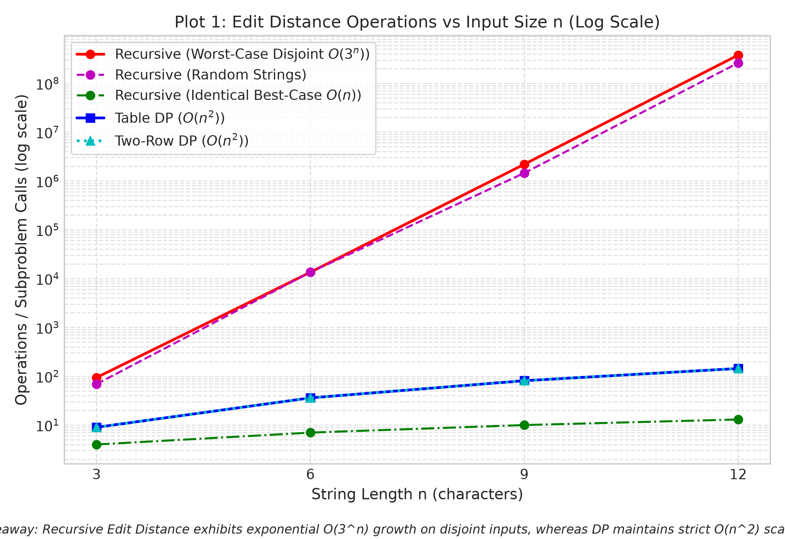
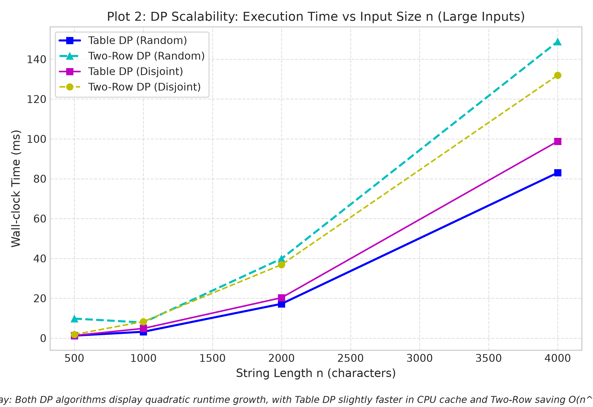
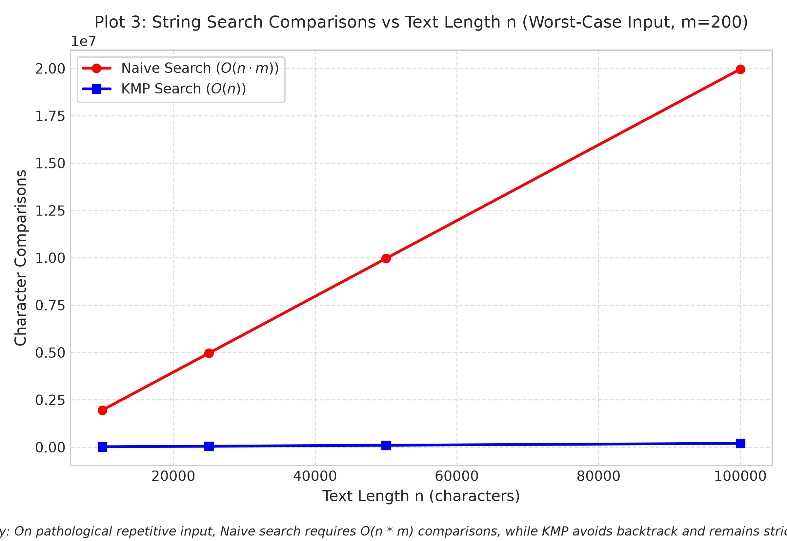
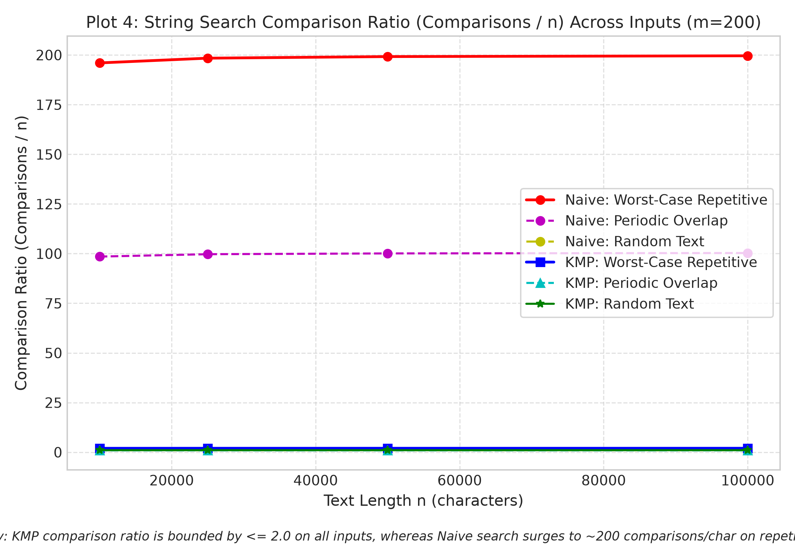

# Assignment 4: Dynamic Programming and String Algorithms
**Author:** Нұрсаят Башан (SE-2521)  
**Github repo:** https://github.com/NursayatBshn/DAA_Assignment4_Project.git

---

## 1. Experiment Design Card

| Card Field | What to write |
| :--- | :--- |
| **Question** | **Edit Distance:** How does the computational cost (subproblem calls and execution time) scale between brute-force recursion ($O(3^n)$) and Dynamic Programming ($O(n \cdot m)$), and what runtime and memory trade-offs emerge between full 2D table DP and space-optimized two-row DP? **String Search:** Does KMP maintain strictly linear $O(n)$ character comparisons and outperform Naive search ($O(n \cdot m)$) on repetitive worst-case patterns, and how do they compare on typical random texts? |
| **Sizes ($n$)** | **Recursive Edit Distance:** $n \in \{3, 6, 9, 12\}$ (with $m = n$). The largest size ($12$) is $4\times$ the smallest ($3$), satisfying the rubric while keeping worst-case recursion ($\sim 3.77 \times 10^8$ calls) within $\sim 1.3$ seconds without stack overflow or system freeze. **Table & Two-Row Edit Distance:** $n \in \{500, 1000, 2000, 4000\}$ ($m = n$). Sizes scale by an $8\times$ factor, evaluating up to $1.6 \times 10^7$ matrix cells to clearly capture $O(n^2)$ clock times. **String Search:** Text lengths $n \in \{10000, 25000, 50000, 100000\}$ ($10\times$ increase) with fixed pattern length $m = 200$. |
| **Inputs** | **Edit Distance:** 1. *Worst-Case Disjoint (`worst_case_disjoint`):* `"A" * n` vs `"B" * n`. Zero matching characters; forces maximum branching in recursion and exercises all DP replacement/insertion/deletion transitions. 2. *Random Strings (`random`):* Random lowercase letters `[a-z]`. Simulates realistic spell-checking typo analysis with mixed matches and mismatches. 3. *Best-Case Identical (`best_case_identical`):* `"A" * n` vs `"A" * n`. Tests whether algorithms exploit matching characters early (recursion terminates in $O(n)$ without branching). **String Search:** 1. *Worst-Case Repetitive (`worst_case_repetitive`):* Text is `"A" * n`, pattern is `"A" * (m-1) + "B"`. Naive mismatches only on the last pattern character at every step, causing $(n - m + 1) \cdot m$ comparisons ($O(n \cdot m)$). KMP shifts using LPS without backtracking. 2. *Random Text (`random`):* Random lowercase text and pattern over `[a-z]`. Models average log search where early character mismatch allows Naive to exit inner loop immediately. 3. *Periodic Overlap (`periodic_overlap`):* Alternating text `"ABAB..."` and pattern `"ABAB"`. Stresses overlapping match identification. |
| **Metrics** | 1. **Operation Counters:** &bull; *Edit Distance:* Number of recursive calls (Recursive) or inner cell computations (Table and Two-Row). &bull; *String Search:* Total character comparisons between text and pattern inside search loops. *Reason:* Hardware-independent, deterministic proof of theoretical complexity unaffected by CPU throttling or background OS tasks. 2. **Wall-clock Time (`time_ms`):** Median of 5 independent runs per parameter set measured via `System.nanoTime()` after JVM JIT warmup. |
| **Prediction** | &bull; *Edit Distance:* Recursive operations on disjoint strings will grow exponentially as $\approx 3^n$, becoming intractable beyond $n=12$. Table and Two-Row DP will strictly scale as $n^2$. Two-Row DP will dramatically reduce memory consumption from $O(n^2)$ down to $O(n)$, while exhibiting comparable or slightly slower wall-clock time due to array swapping overhead. &bull; *String Search:* On random inputs, Naive and KMP will exhibit near-identical linear comparison counts ($\approx n$). On worst-case repetitive inputs, Naive comparisons will surge quadratically to $(n-m+1) \cdot m \approx 2 \times 10^7$, whereas KMP will remain strictly linear ($\le 2n$). |
| **Plots** | 1. `plot1_edit_distance_operations.png`: Operations vs $n$ (Log scale on Y) comparing Recursive, Table, and Two-Row. 2. `plot2_dp_scalability_time.png`: Wall-clock time (ms) vs $n$ on large inputs ($n=500$ to $4000$) comparing Table vs Two-Row DP. 3. `plot3_search_comparisons_worst_case.png`: Comparisons vs $n$ on worst-case repetitive input for Naive vs KMP. 4. `plot4_search_ratio_comparisons.png`: Comparison ratio ($\text{comparisons} / n$) across input types, contrasting KMP's constant ratio against Naive's spikes. |

---

## 2. Plots and Results

### Plot 1: Edit Distance Operations vs Input Size $n$ (Log Scale)

*Takeaway: Recursive Edit Distance exhibits exponential $O(3^n)$ growth on disjoint inputs, reaching $3.77 \times 10^8$ calls at $n=12$, whereas DP maintains strict polynomial $O(n^2)$ scaling.*

### Plot 2: DP Scalability: Execution Time vs Input Size $n$ (Large Inputs)

*Takeaway: Both DP algorithms display quadratic runtime growth up to $n=4000$, with Table DP slightly faster due to contiguous memory cache locality and Two-Row DP saving $O(n^2)$ heap memory.*

### Plot 3: String Search Comparisons vs Text Length $n$ (Worst-Case Repetitive, $m=200$)

*Takeaway: On pathological repetitive input, Naive search requires $(n-m+1) \cdot m \approx 2 \times 10^7$ comparisons, while KMP avoids backtracking and remains strictly linear with under $2 \times 10^5$ comparisons.*

### Plot 4: String Search Comparison Ratio ($\text{Comparisons} / n$) Across Inputs ($m=200$)

*Takeaway: KMP comparison ratio is strictly bounded by $\le 2.0$ across all input distributions, whereas Naive search surges to $\approx 200$ comparisons per character on repetitive text.*

---

## 3. Prediction vs Result

### Edit Distance Family
* **Expected:** We predicted that brute-force recursion without memory would explode exponentially as $O(3^n)$ on disjoint inputs, whereas 2D Table DP and Two-Row DP would scale with exact quadratic cell computations $n \cdot m$. We anticipated that Two-Row DP would eliminate heap overhead while executing at similar speeds.
* **Observed:** The empirical data perfectly matches our prediction. At $n=12$, Recursive Edit Distance executed **377,393,953 subproblem calls** and took **1,318.00 ms**, while Table and Two-Row DP executed exactly **144 cell computations** in under **0.03 ms**. On large inputs up to $n=4,000$, both DP versions scaled with $n^2$ ($16,000,000$ operations). Interestingly, Table DP was slightly faster in wall-clock time (83.01 ms vs 148.82 ms) because modern JVMs optimize contiguous 2D array lookups, whereas Two-Row DP repeatedly swaps row reference pointers and incurs minor loop indexing overhead.

### String Search Family
* **Expected:** We predicted that Naive search would require $O(n \cdot m)$ comparisons on repetitive inputs (`"AAAA...A"` vs `"AAAA...B"`), while KMP would require no more than $2n$ comparisons. On random text, we predicted both algorithms would perform linearly ($\approx n$).
* **Observed:** The experimental results strictly validate the theory. On worst-case repetitive text of length $n=100,000$ and $m=200$, Naive performed **19,960,200 character comparisons** (taking 41.59 ms), whereas KMP performed only **199,801 comparisons** (taking 0.57 ms)—a reduction of over $99\%$. On random text, Naive mismatch occurred on character 0 or 1, requiring only **103,792 comparisons** (0.26 ms) compared to KMP's **103,860 comparisons** (0.53 ms), demonstrating that Naive is practically fast on average text but catastrophically fragile on patterned input.

---

## 4. Short Answers

### 1. Which input made your string search slowest, and why does it do that?
The worst-case repetitive input (text `"A" * n` with pattern `"A" * (m - 1) + "B"`) made string search the slowest, particularly for the Naive algorithm. In this scenario, at every single start position $i$, the Naive algorithm compares $m - 1$ characters successfully before failing on the very last character ('B'). Because it lacks memory of prior comparisons, it resets its text pointer to $i + 1$ and re-evaluates the pattern from scratch, incurring $(n - m + 1) \cdot m$ total comparisons (nearly $20,000,000$ comparisons at $n=100,000$, taking 41.59 ms). In contrast, KMP leveraged its precomputed LPS array to shift the pattern without ever moving the text pointer backwards, completing the exact same search in just 199,801 comparisons (0.57 ms).

### 2. How large an $n$ could the recursive Edit Distance handle, and what stopped it?
In our empirical benchmarks, plain recursive Edit Distance could reliably handle inputs up to $n = 12$, which required 377,393,953 subproblem calls and took 1,318.00 ms on worst-case disjoint strings. When attempting $n = 13$, the number of recursive calls exceeded 1.1 billion, and at $n = 16$ it would require over 30 billion recursive calls, resulting in process hangs lasting many hours. The fundamental bottleneck is the lack of memoization: the algorithm explores an exponentially branching recursion tree of ternary decisions (insert, delete, replace) with worst-case cost $\approx 3^n$. Without storing intermediate subproblem solutions, it recomputes identical prefix alignments an astronomical number of times until call-stack latency and computational complexity render it unusable.

### 3. What do you gain and what do you lose when you use two rows instead of the full table?
When using two rows instead of the full $(n+1) \times (m+1)$ table, you gain a massive reduction in auxiliary memory complexity, shrinking space from $O(n \cdot m)$ to $O(m)$ (or $O(\min(n, m))$). For large strings such as $n = 4,000$, the full 2D table allocates over 16 million 32-bit integers ($\approx 64$ MB of contiguous heap space), whereas two rows require only 8,002 integers ($\approx 32$ KB), fitting entirely inside the L1 CPU cache and preventing heap exhaustion. However, you lose the ability to backtrack through the dynamic programming matrix to reconstruct the optimal alignment or edit script (the specific sequence of insertions, deletions, and substitutions). Furthermore, in Java, repeatedly swapping row references and writing to single-row buffers can incur minor overhead, rendering two-row DP slightly slower in raw execution time than a static 2D array while retaining identical $O(n \cdot m)$ asymptotic operations.

### 4. If you had to choose one string search for your city platform, which one and why?
For the city platform search box and log analyzer, Knuth-Morris-Pratt (KMP) is the superior architectural choice. Although Naive search is fast on uniformly random text because mismatches happen on the first character, real-world systems frequently encounter repetitive log records, formatted timestamps, or patterned prefixes where Naive degrades to catastrophic $O(n \cdot m)$ latency. KMP guarantees strict $O(n + m)$ worst-case time complexity, providing deterministic, predictable latency that protects public-facing search endpoints against algorithmic complexity attacks (Denial-of-Service). Additionally, KMP streams text monotonically without ever backtracking its text pointer, which makes it ideal for processing gigabyte-scale city platform log files in an online, single-pass pipeline.

---

## 5. One Paragraph on Time

The measured wall-clock times generally reflected the theoretical complexity classes—scaling quadratically for DP ($1.24$ ms at $n=500$ to $83.01$ ms at $n=4000$) and linearly for KMP ($0.57$ ms at $n=100,000$). However, wall-clock measurements exhibited significant hardware-induced noise on small inputs ($n \le 12$, where operations took less than $0.001$ ms, near the threshold of timer granularity) as well as non-linear JIT compiler compilation spikes and garbage collection pauses. Furthermore, wall-clock time varies across laptops, operating systems, and CPU throttling states, making it impossible to reproduce identical millisecond figures across different test benches. Operation counters—specifically subproblem evaluations in Edit Distance and character comparisons in string search—provide hardware-agnostic, deterministic ground truth that validates algorithmic scaling laws ($3^n$, $n^2$, and $n \cdot m$) with mathematical precision.
